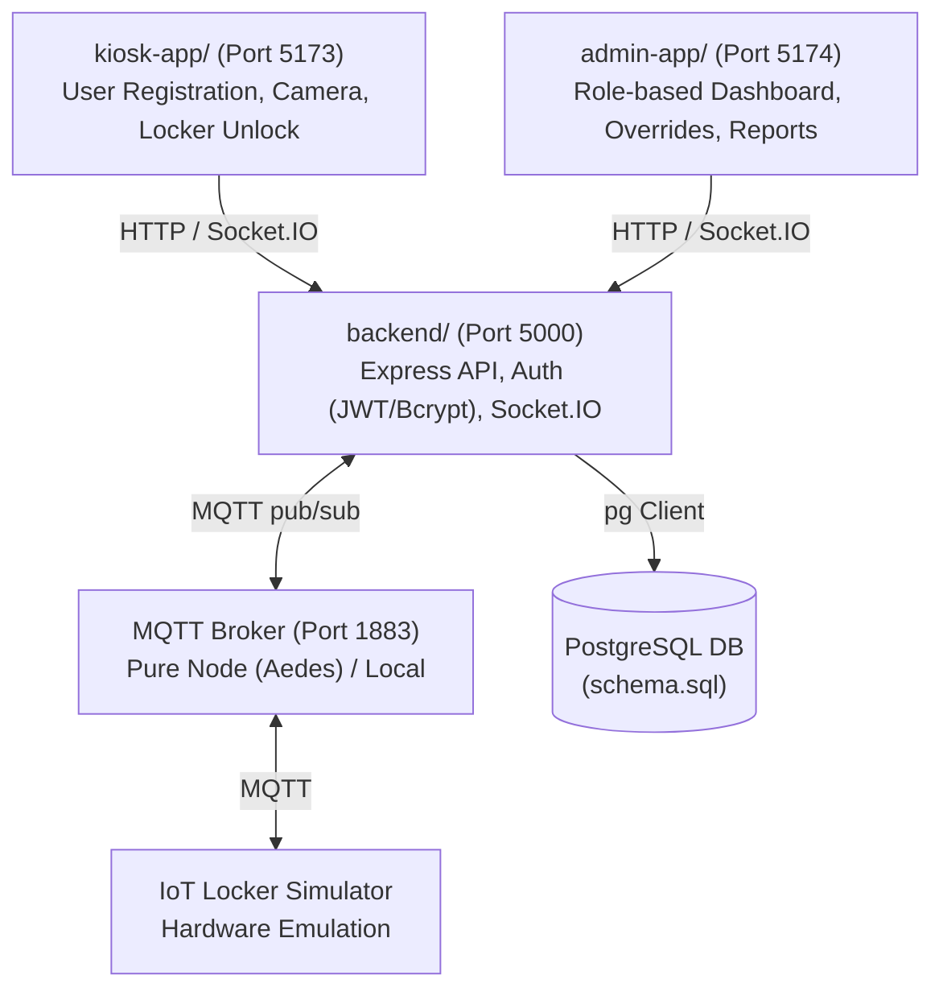

# Smart Locker System: Architecture & Phase 0 Implementation Plan

We are adopting your multi-phase roadmap for the Smart Locker System, specifically configured to run locally on your system (**without Docker**) and ready to accept your upcoming PostgreSQL table schemas.

---

## User Constraints & Core Directives

> [!IMPORTANT]
> 1. **No Docker**: All components (backend, kiosk, admin, IoT broker/simulator) run directly on your system via Node.js without any Docker containers.
> 2. **PostgreSQL Schema on Hold**: We will skip DB table creation until you provide the `schema.sql` definitions.
> 3. **Monorepo Layout**:
>    - `kiosk-app/`: Vite + React user-facing kiosk interface.
>    - `admin-app/`: Vite + React management dashboard for Super Admins, Branch Admins, and Staff.
>    - `backend/`: Express REST API + Socket.IO server + MQTT coordinator.
>    - `broker/` (or embedded): Lightweight pure Node.js MQTT broker (using `aedes`) so MQTT runs instantly without Mosquitto or Docker installs.
>    - `schema.sql`: Root SQL schema file (awaiting your table definitions).

---

## User Review Required

> [!NOTE]
> - **Existing Directory Migration**:
>   - We currently have `client/` and `server/`. We will migrate `client/` to `kiosk-app/` and `server/` to `backend/`, and create `admin-app/`.
> - **Root Package Cleanup**:
>   - In `server/package.json`, `"lockers-prototype": "file:.."` was recently added. When moving to `backend/`, we will normalize package dependencies to avoid circular module resolution.

---

## Open Questions

> [!IMPORTANT]
> 1. **Table Schema**: Whenever you're ready, share your PostgreSQL table schemas (or paste them in `schema.sql`).
> 2. **MQTT Broker Setup**: For running locally without Mosquitto/Docker, do you prefer:
>    - **Option A (Recommended)**: An embedded pure-Node MQTT broker (`aedes`) that starts automatically with `backend` or via a dedicated script (`npm run broker`), zero external installs required.
>    - **Option B**: A pre-installed Windows Mosquitto service running on `localhost:1883`.

---

## Proposed Roadmap Breakdown



---

## Proposed Changes: Phase 0 Foundations

### 1. Monorepo Reorganization

Migrate the current layout into the target roadmap layout:

#### [NEW] [kiosk-app/](file:///c:/Users/Rohit/OneDrive/Documents/lockers/kiosk-app)
- Migrate existing `client/` files into `kiosk-app/` (port 5173).
- Configured for kiosk UI (camera flow, locker unlock notifications).

#### [NEW] [admin-app/](file:///c:/Users/Rohit/OneDrive/Documents/lockers/admin-app)
- Scaffold lightweight React + Vite app for Admin (port 5174).
- Setup structure for role-based navigation (Super Admin vs. Branch Admin vs. Staff).

#### [NEW] [backend/](file:///c:/Users/Rohit/OneDrive/Documents/lockers/backend)
- Migrate `server/` to `backend/` (port 5000).
- Dependencies: `express`, `cors`, `dotenv`, `jsonwebtoken`, `bcryptjs`, `socket.io`, `mqtt`, `pg`.
- Add local embedded MQTT broker script (`aedes`) for zero-dependency local MQTT.

#### [NEW] [schema.sql](file:///c:/Users/Rohit/OneDrive/Documents/lockers/schema.sql)
- Placeholder file ready for the PostgreSQL table schemas you will provide.

#### [MODIFY] [package.json](file:///c:/Users/Rohit/OneDrive/Documents/lockers/package.json)
- Unified root scripts to run any or all services concurrently:
  - `npm run dev`: starts `backend`, `kiosk`, and `admin` concurrently.
  - `npm run dev:kiosk`: runs only `kiosk-app`.
  - `npm run dev:admin`: runs only `admin-app`.
  - `npm run dev:backend`: runs only `backend`.
  - `npm run broker`: starts the embedded MQTT broker (if running standalone).

---

## Next Steps (Phases 1 — 6)

1. **Phase 1 — Backend Core**:
   - Apply user's PostgreSQL `schema.sql`.
   - Setup Auth: `POST /api/auth/login`, JWT issuing, password hashing with `bcryptjs`, role check middleware (`super_admin`, `branch_admin`, `staff`).
   - Hierarchy CRUD: companies → cities → branches → wards → lockers.
   - Employee CRUD with password hashing & activation status.
2. **Phase 2 — Kiosk Flow**:
   - Provisioning (ward_id / branch_id injection).
   - Registration → photo capture → MQTT unlock dispatch → device ack polling.
3. **Phase 3 — Locker IoT Simulator**:
   - Lightweight Node simulator subscribing to commands and publishing heartbeat/status events.
4. **Phase 4 — Admin App**:
   - Login view + role-based navigation.
   - Live dashboard wired to backend Socket.IO (`locker:update`, `locker:heartbeat`).
   - Ward locker summary & manual force override.
5. **Phase 5 — Reporting & Logs**:
   - Event history & occupancy trend endpoints.
6. **Phase 6 — Hardening**:
   - Offline resilience, rate limiting, and MQTT LWT.

---

## Verification Plan

### Automated / Sanity Checks
- Verify directory structure:
  ```powershell
  Test-Path kiosk-app, admin-app, backend, schema.sql
  ```
- Install dependencies across all packages:
  ```powershell
  npm run install:all
  ```
- Test client builds (`kiosk-app` & `admin-app`):
  ```powershell
  npm --prefix kiosk-app run build
  npm --prefix admin-app run build
  ```
- Test backend syntax and startup:
  ```powershell
  node --check backend/src/index.js
  ```

### Manual Verification
- Run `npm run dev` to verify that `backend` (port 5000), `kiosk-app` (port 5173), and `admin-app` (port 5174) start up without conflicts.
